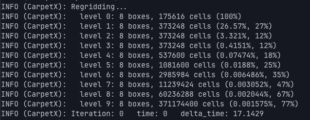

# Best Practices for Running CarpetX on GPU HPCs

A few parameter-file settings that matter for performance when running CarpetX-based codes (SpacetimeX, AsterX, ...) on GPUs.

## 1. Turn off debug-only parameters

These options add extra work (logging, filling grid functions with poison values and checking them) that is useful for debugging but slows down production runs:

```
CarpetX::verbose = no
CarpetX::poison_undefined_values = no
CarpetX::poison_undefined_arrays = no
```

## 2. Set `max_tile_size` and `max_grid_size`

### 2.1 Set `max_tile_size` to a large number

Tiling helps CPU cache reuse, but on GPUs each box should be processed as a single big tile so that each kernel launch covers as many points as possible:

```
CarpetX::max_tile_size_x = 10240000
CarpetX::max_tile_size_y = 10240000
CarpetX::max_tile_size_z = 10240000
```

### 2.2 Set `max_grid_size` appropriately

`max_grid_size` sets the maximum box size, and hence how many boxes each refinement level is split into.

**Rule of thumb:** each level should have as many boxes as the number of GPUs (MPI ranks) you run on, so that every GPU gets exactly one box per level.

Example: a 3-level grid where each level has $256^3$ points, running on 8 GPUs:

```
CarpetX::max_grid_sizes_x = [ 128, 128, 128 ]
CarpetX::max_grid_sizes_y = [ 128, 128, 128 ]
CarpetX::max_grid_sizes_z = [ 128, 128, 128 ]
```

Each level is then split into $(256/128)^3 = 8$ boxes, one per GPU.

### 2.3 Check the result

CarpetX reports the number of boxes per level in the run's `stdout` (see the full example in [`refs/stdout.txt`](refs/stdout.txt)):

```
$ grep "boxes" stdout.txt
INFO (CarpetX):   level 0: 8 boxes, 175616 cells (100%)
INFO (CarpetX):   level 1: 8 boxes, 373248 cells (26.57%, 27%)
INFO (CarpetX):   level 2: 8 boxes, 373248 cells (3.321%, 12%)
```


